# Exterior recovery comparison gallery

Left: original. Centre: repaired high detail. Right: optimized candidate. Matching lighting, exposure, cameras and framing; no depth of field. Individual full-resolution PNGs are alongside each sheet. See README.md for limitations.

## Front three-quarter

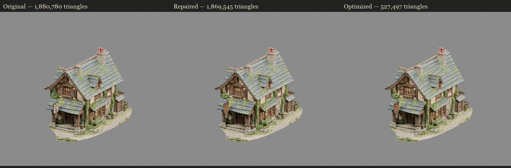

## Front entrance

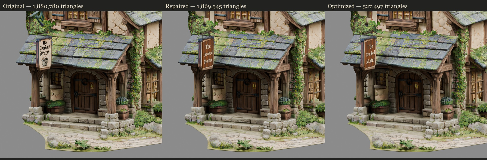

## Side

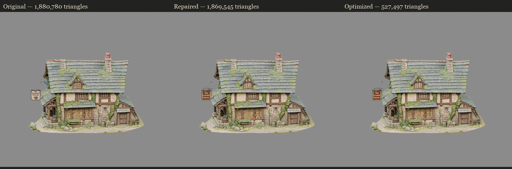

## Rear

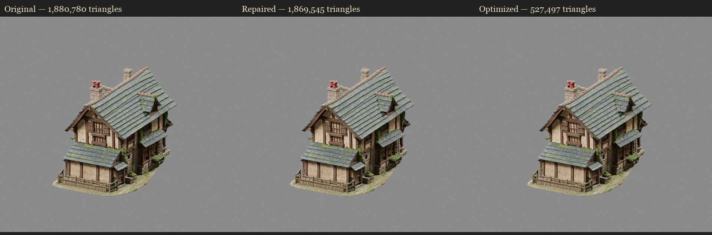

## Roof from above

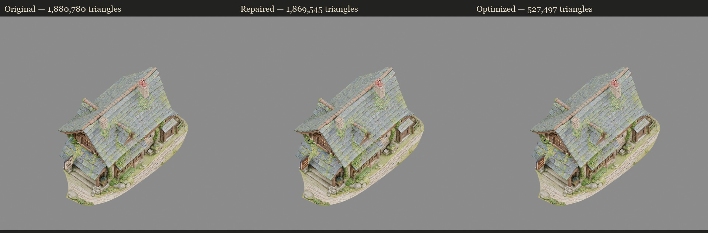

## Sign lettering

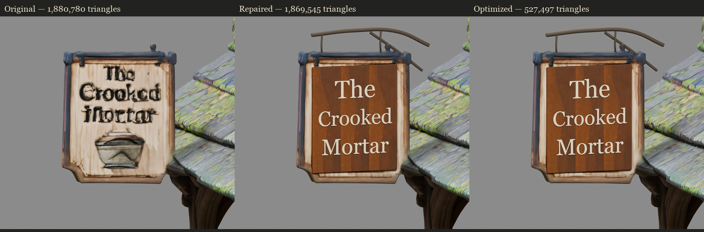

## Gameplay distance

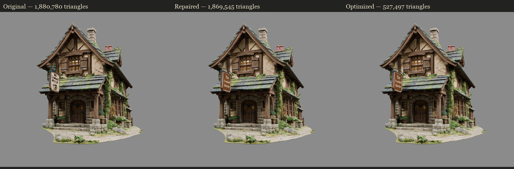

## Slate / roof close-up

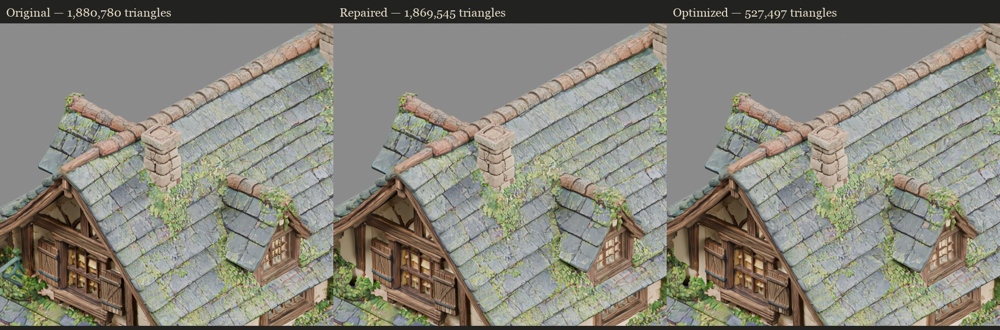

## Timber close-up

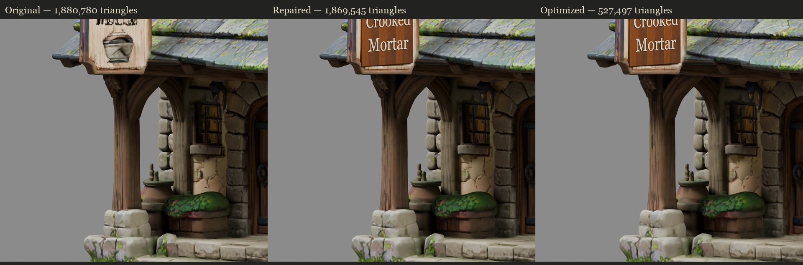

## Foliage close-up

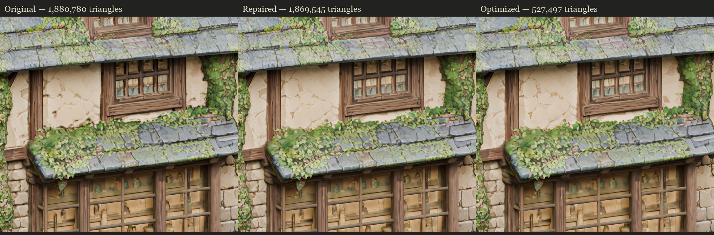

## Window and former malformed cluster

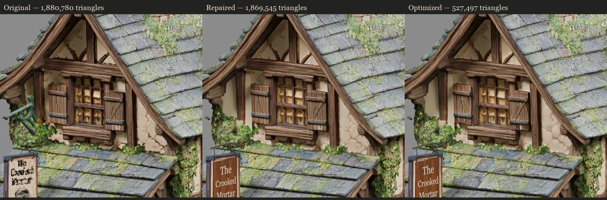

## Unity exterior preview

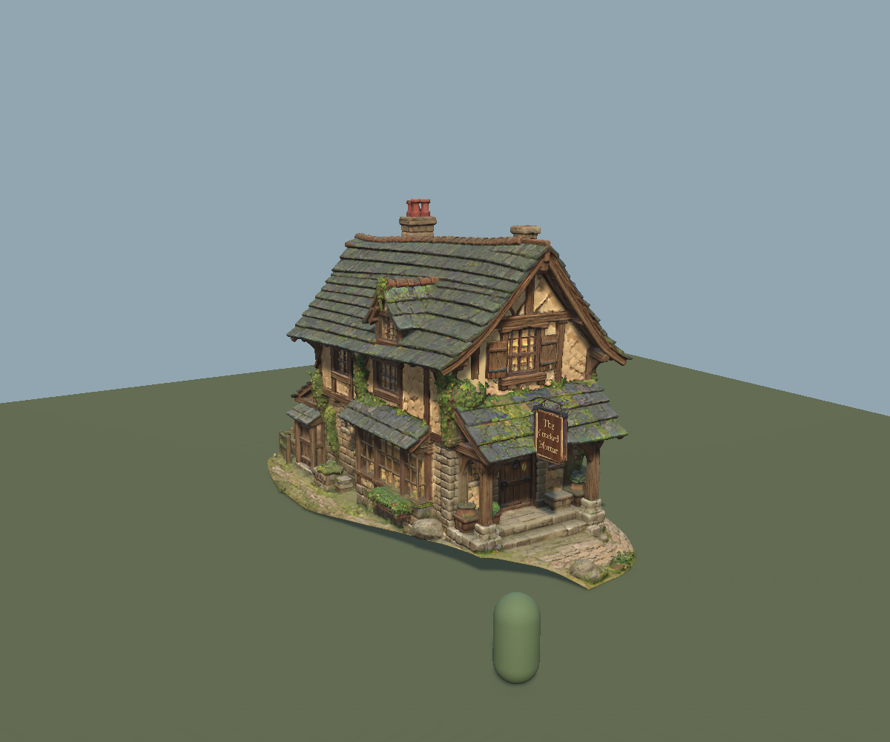

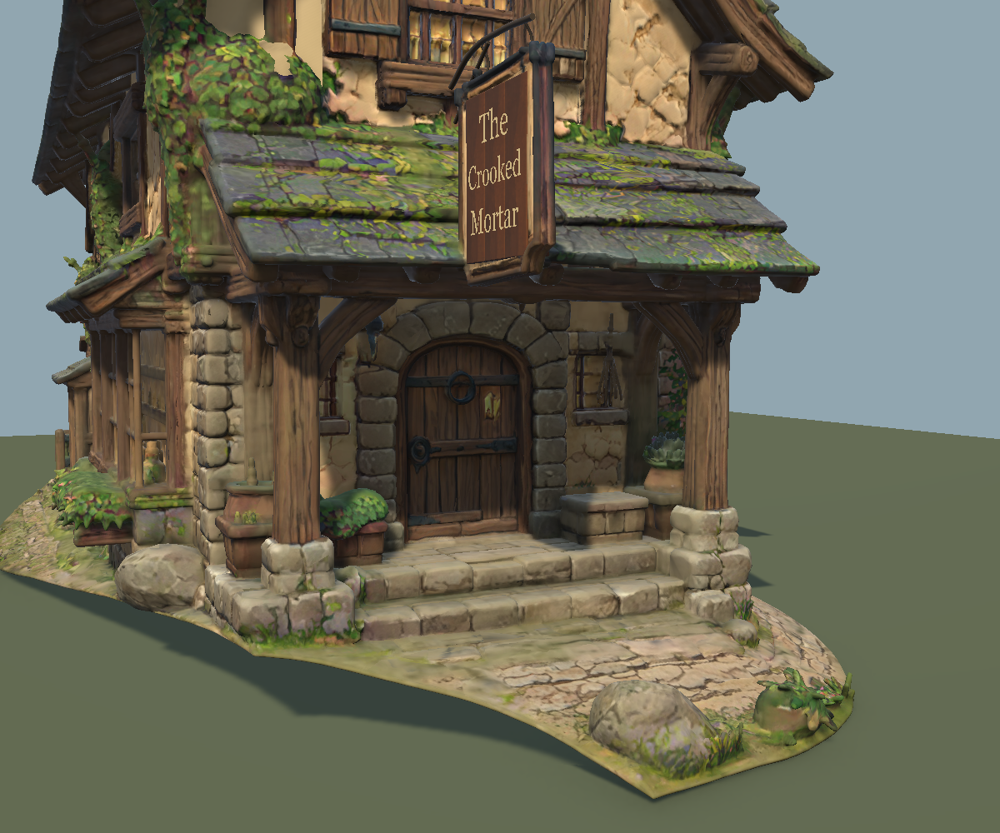

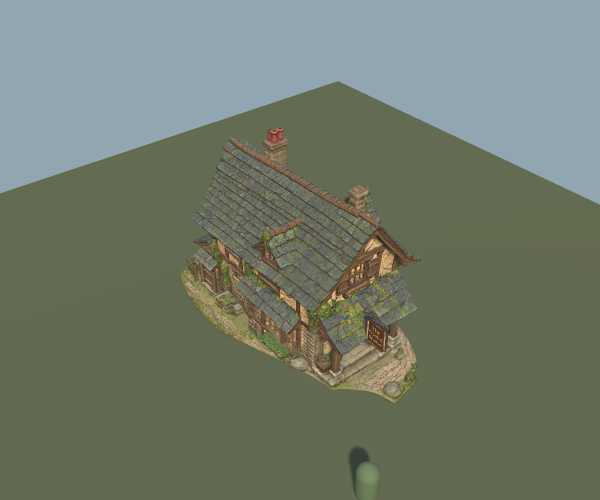

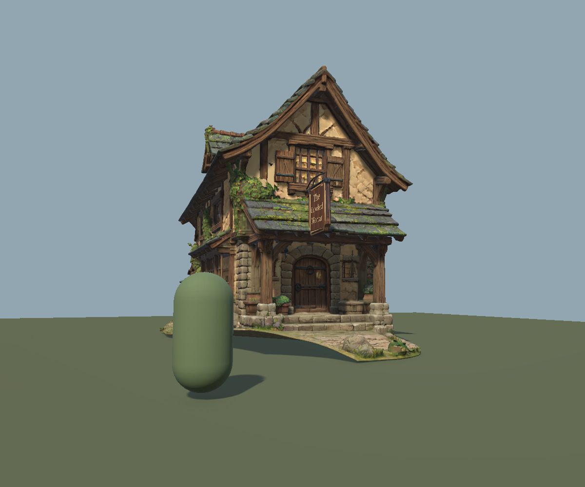

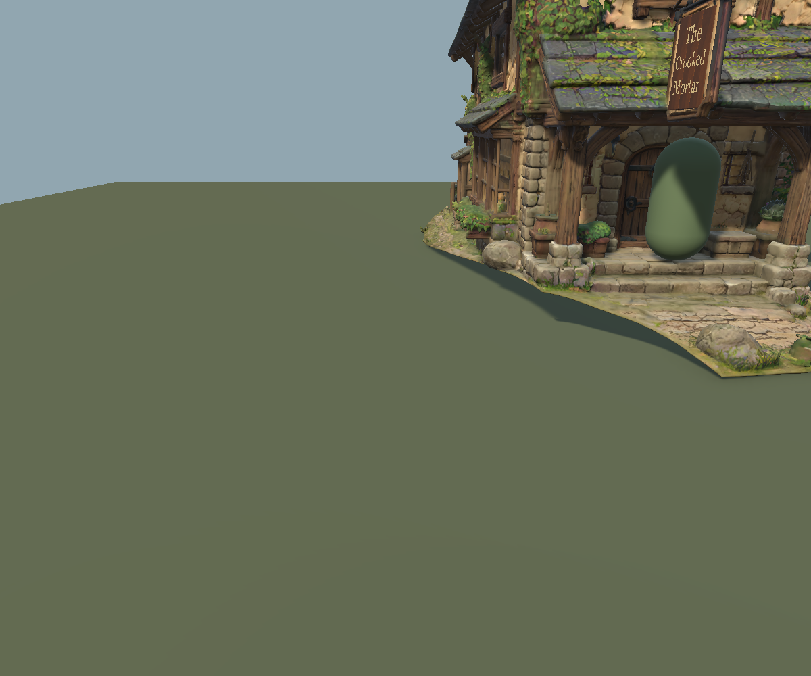

