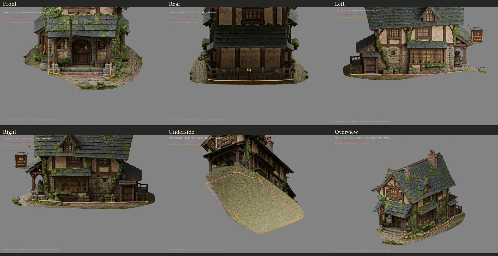

# Crooked Mortar — terrain separation boundary mapping

**Mapping only. STOPPED for review. No cut, deletion, separation, reconstruction, export or Unity prefab creation was performed.**

Open `CM_CrookedMortar_BoundaryMapping01_UNCUT.blend`. This is a new duplicate of the existing `../SeparationInspection_UNCUT.blend`; the original inspection and recovery files remain untouched.

## Reading the proposal

- **Magenta:** more readily identifiable proposed contact boundary beneath the retained front step, side foundation stones and annex thresholds. These are review guides, not certified mesh edges or authorization to cut.
- **Orange:** provisional connectors / uncertain contact zones. Resolve these before any separation. They deliberately do not imply an exact safe edge where the visible source is ambiguous.
- Keep the architectural faces on the **building side** of the proposed boundary; the surrounding paths, terrain skirt and loose terrain contents are the removal side, subject to review. This is not a blanket XY selection rule: the continuous terrain underside inside the outline must also be dealt with separately after approval.
- The surface guide is lifted **25 mm** for readability. It is an editable separate poly-curve, not snapped mesh topology or a boolean operand. Thick display strokes are not a cutting tolerance.
- Underside curves are an **XY footprint projection at Z = -0.10 m**, shown through the existing platform. They do not locate a hidden foundation underside or approve a cut elevation.
- Elevation renders use annotation-only compositing so foliage cannot hide the proposed line. The overview shows only the near-side segments to avoid misleading through-building diagonals. Use the four elevations and underside together to review the whole loop.
- Coordinates are Blender metres: front = -Y, left = -X, right = +X. FBX import into Unity changes the X convention; do not reuse point coordinates in Unity without the established conversion.

## Is a continuous safe boundary identifiable?

A **continuous provisional loop** is identifiable: 45 segments, with 15 magenta proposed segments and 30 orange review segments. The ordered loop closes and has no strict XY self-intersections in the diagnostic check.

A **continuously verified safe cut path is not yet established**. The orange portions include conservative contact proposals and connections across obscured areas. One manually examined left-side porch-to-bay point had no visible surface hit; that span is orange rather than treated as a known edge. The trace was chosen from actual front/rear/left/right renders and located by ray casts for guide placement only. No automatic height mask, perimeter crop or geometry classifier was applied.

## Areas requiring review

| ID | Area | What is unresolved / what to preserve |
|---|---|---|
| U1 | Both porch-base corners and step returns | Irregular base stones and grass obscure the lowest structural edge. Preserve entire support bases, lowest tread/riser, and projecting corner stones. The central front-step run is more readable; the returns are not assumed safe. |
| U2 | Porch-to-shop-bay returns, especially the rock/ivy cluster | Separate loose terrain boulders from foundation stones and attached ivy/planters. The orange span must be resolved around actual stone faces, not by slicing through the vegetation or using its bounding box. |
| U3 | Ground-level containers and masonry herb beds beside both side annexes | Preserve building-attached planters, their stone containers and retained plant roots; distinguish fused soil/grass from planted contents and loose terrain growth. The exact contact is partly obscured. |
| U4 | Rear fence/plinth and both rear corners | The rear wooden enclosure and lower plinth are provisionally inside the keep envelope. Whether all of this belongs to the building or terrain dressing needs explicit review. Do not silently remove fence feet or retain its entire surrounding terrain strip. |

There is **no approved underside cut level** anywhere. Pink underside lines carry the confidence of the corresponding visible contact in XY only.

## Would terrain removal expose holes?

Yes, it is expected to expose open lower returns and underside boundaries. The existing platform is a continuous surface fused to the building; the inspection does not reveal a finished, independent foundation underside. The exact hole count and shape cannot be certified without splitting along an approved edge path. No split was made to test this.

## Recommended separation method after approval

1. Resolve U1–U4 on the actual visible surfaces and approve a revised keep/remove contour. Treat these guide objects as references; do not automatically run a knife projection or boolean with them.
2. Trace the approved contour onto the existing mesh with local edge placement, preserving architectural face positions and per-corner UVs. Separate only the terrain-side selection, inspecting every retained foundation stone, porch base, step and attached botanical contact.
3. Inspect newly exposed boundaries from below. Remove the remaining terrain underside beneath the building only after the retained foundation/step shells are identified. Plan local lower returns/closures with matching materials; reconstruct nothing above those necessary contact areas.
4. Validate the complete perimeter and retained steps before adjusting the placement origin, preparing new building-only collision and exporting a standalone candidate.

No height cut, rectangular crop, whole-component deletion, restyling or new optimization is recommended.

## Deliverable views

| View | Marked render |
|---|---|
| Front | [Boundary_Front.png](Boundary_Front.png) |
| Rear | [Boundary_Rear.png](Boundary_Rear.png) |
| Left | [Boundary_Left.png](Boundary_Left.png) |
| Right | [Boundary_Right.png](Boundary_Right.png) |
| Underside projection | [Boundary_Underside.png](Boundary_Underside.png) |
| Elevated three-quarter | [Boundary_Overview.png](Boundary_Overview.png) |
| Six-view contact sheet | [Boundary_AllViews.jpg](Boundary_AllViews.jpg) |

## Non-destructive structure and checks

New annotations are isolated in `BOUNDARY_MAPPING_ONLY__NO_CUT_NO_EXPORT`:

- `01_Proposed_Surface_Guide_EDITABLE`: proposed/review segment curves, with side/status metadata.
- `02_XY_Projection_ONLY_Not_UndersideCut`: separate underside footprint projection, disabled by default in the saved viewport.
- `03_Review_Callouts_And_Legend`: U1–U4 labels and render legends.

Original source collections remain as they were. All new objects are annotation curves or text; **zero new building meshes** were added. The saved copy uses ordinary depth visibility for surface guides; the published renders add annotation overlays for legibility.

`PreservationValidation.json` verifies that every original mesh's vertex coordinates, edge/face connectivity, UV layers, material assignments and object transforms match the pre-annotation hashes, and that all original material-node signatures remain unchanged. The source inspection file's SHA256 is unchanged. The annotation-only overview refinement also rechecked original mesh hashes. Original textures were not written or repainted.

`GuideValidation.json` records loop closure and XY crossing checks. These validate the guide's bookkeeping, **not** the safety of cutting the mesh. `BoundaryProposal.json` contains the exact segment points/status/reasons. `ManualElevationPicks.json` records the manually chosen image locations and their surface hits.

The full building remains approximately **527,497 render triangles**; annotation curve tessellation is not part of the asset triangle budget. No re-optimization was performed.

No Unity scenes, materials, prefabs, scripts or settings were touched. No gameplay/Unity regression tests were run because this work consists exclusively of Blender inspection annotations. No commit or push.

Reproduction scripts are scoped to this new folder: `inspect_views.py`, `trace_points.py`, `create_boundary_map.py`, `refine_overview.py`, `render_near_overview.py`, and `compose_reviews.py`. Read before running. `refine_overview.py` changes only annotation presentation, not the proposed contact points or building.
