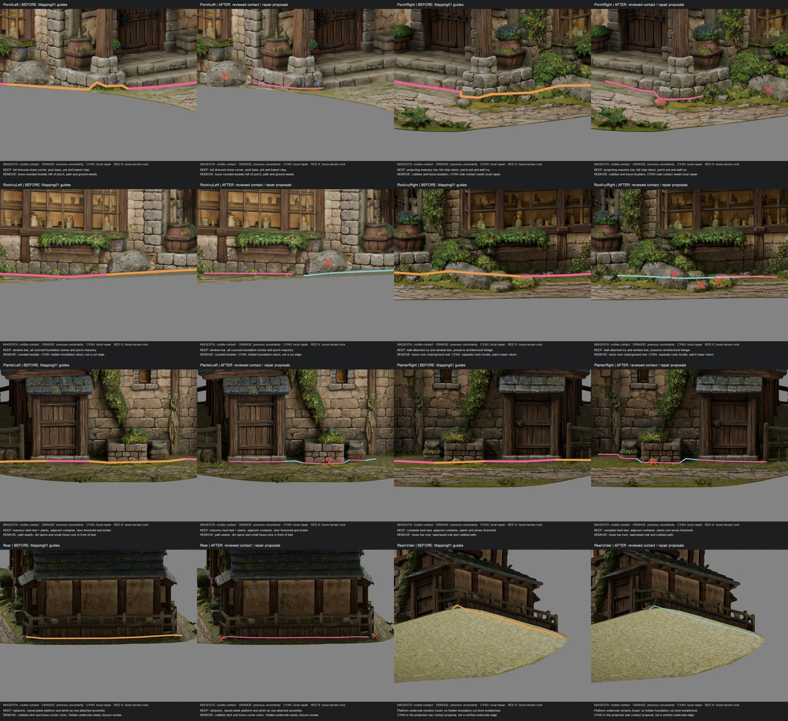

# Crooked Mortar — BoundaryMapping02, uncertain-contact review

**Inspection only. No geometry has been cut, deleted, separated, rebuilt, restyled or exported. No Unity files changed. STOP for approval.**

Editable copy: [CM_CrookedMortar_BoundaryMapping02_UNCUT.blend](CM_CrookedMortar_BoundaryMapping02_UNCUT.blend).

This duplicates BoundaryMapping01, preserving the previous inspection and all recovery sources. Eight close-up camera positions were inspected, including below the rear platform. Before/after images show **changes to annotations only**, with identical house geometry, camera, lighting and exposure.

## Reading the revised markings

- **Magenta:** manually reviewed visible architectural contact proposal. Keep the dressed masonry, containers, steps and timber above/behind that contact as described below.
- **Cyan:** obscured or fused contact requiring localized lower-return/plant-root repair **after approval**. These lines are approximate repair locations, not known mesh edges or safe cutting coordinates.
- **Red crosses:** specific loose terrain-rock exclusions for review. They are not deletion selections. A face index is recorded only to relocate each picked surface, not to authorize deleting an entire component.
- **Orange appears in the BEFORE panels only:** prior unresolved guide spans.

These are separate 3D annotation curves. Surface guides have an approximately 18 mm display lift; crosses are offset toward their inspection camera for legibility. The rendered overlays deliberately remain visible through occluding foliage. The saved Blender guides use ordinary depth visibility.

The new collection is `BOUNDARY02_REVIEW_ONLY__NO_CUT`. Mapping01 annotations and superseded detail paths remain excluded in separate collections. New detail polylines refine local contacts; **they do not form a newly certified, watertight continuous cutting loop**. The original full loop remains available as historical context. No blanket XY or height selection is safe.

## Ownership decisions and remaining technical ambiguity

| Area | Retain | Exclude from future standalone asset | Residual issue / proposed local repair |
|---|---|---|---|
| U1, left porch corner and lowest step | Full coursed stone corner, post pedestal, lowest tread/riser and return, porch pot and its plants | Rounded boulder beside the corner, surrounding cobbles, earth and ground weeds | Visible dressed-stone toe is now traced rather than following the boulder. Its hidden rear contact joins U2-left; preserve the full stone, patch only an exposed lower return if needed. |
| U1, right porch corner | Projecting masonry toe, pedestal, full step return and porch planter | Loose toe pebble, path and rounded rocks outside masonry | Follow the squared load-bearing courses, not the irregular grass line. Root mat at the side return belongs to U2-right repair review. |
| U2-left, porch/window-bay return | Coursed wall foundation, corner masonry, projecting window box and attached vegetation | Large isolated rounded boulder leaning against foundation, ground weeds | The rock hides the foundation contact. Cyan marks a **repair corridor**, not a trace of an invisible surface. After approval, trace exposed stone edges around the rock attachment and create only the missing lower stone return with matching UV/material treatment. Do not flatten the stone face. |
| U2-right, ivy/rock cluster | Vertical ivy rooted against the building, trailing leaves visibly connected to wall growth, window box and all load-bearing courses | Rounded rock chain, path stones, independent low weeds and terrain moss mat | Wall ivy merges visually/geometrically with the ground mat. There is no reliable single ownership edge through that fused root cluster. Preserve the hanging/vertical ivy silhouette; propose a short lower stem termination and local foundation return where removal exposes gaps. No botanical or foundation reconstruction performed. |
| U3-left, annex planter | Entire masonry herb bed, soil and planted growth, adjacent small container, threshold and timber foot | Small rounded stone in front of bed, path and surrounding grass/earth | Visible container bottoms are mapped. Cyan connectors between threshold, bed and adjacent vessel indicate recessed/obscured contacts. They must be fitted around each object independently rather than retaining a strip of terrain between them. Close only newly exposed container bottoms/lower returns later. |
| U3-right, annex planter | Same rule: complete bed, adjacent vessel, contents and annex threshold | Loose toe stone, lawn mat and cobbled apron | Recessed transitions are cyan. Do not infer a continuous foundation face from the foreground grass. Preserve wall ivy above the bed. |
| U4, rear rail and plinth | Entire rear railing, terminal posts/feet, raised plank platform and vertical plank plinth | Cobble skirt outside platform, loose rocks outside post feet, ground weeds | Rear and underside views show a coherent raised assembly meeting annex thresholds, so classify it as retained building appendage. The continuous terrain underside hides its bottom construction. Cyan marks the projected contact only; later provide local bottom returns beneath retained plinth/feet, not a new terrace or redesign. |

No building-attached decorative element is proposed for deletion. Small freestanding containers immediately beside the masonry beds and pots sitting on porch masonry are intentionally retained. Detached path weeds and boulders are not automatically preserved just because they touch the house. Red crosses are examples of the reviewed loose stones, not an exhaustive list of every terrain weed or pebble.

## Is the boundary ready for approval?

The **keep/remove ownership proposal has been reviewed across all previously orange zones** and is ready for visual approval with the qualifications above. A wholly visible, exact safe face-level cut is **not** established behind the left boulder, through the right root mat, at recessed planter connectors or below the rear platform. These remain clearly marked cyan; they must not be silently treated as resolved mesh topology.

Recommended approval scope: the retained architectural envelope and exclusion choices, plus permission for careful local separation and matching lower-return repairs at the cyan contacts. Cutting is still unauthorized in this deliverable. If reconstruction is not approved, preserve the fused contacts until manual mesh surgery can resolve them; do not use an aggressive boolean or height cut.

After any future approved separation, inspect exposed boundaries individually and retain existing stone-face positions and per-corner UVs. The continuous terrain underside will likely leave openings. Its eventual removal and local closures require inspection during that later stage; no exact hole count can be certified without splitting the mesh.

## Matched close-ups

| Section | Before/after boundary comparison |
|---|---|
| Left porch and step return | [PorchLeft](PorchLeft_Comparison.jpg) |
| Right porch and step return | [PorchRight](PorchRight_Comparison.jpg) |
| Left boulder/foundation contact | [RockIvyLeft](RockIvyLeft_Comparison.jpg) |
| Right ivy/rock contact | [RockIvyRight](RockIvyRight_Comparison.jpg) |
| Left annex herb bed and container | [PlanterLeft](PlanterLeft_Comparison.jpg) |
| Right annex herb bed and container | [PlanterRight](PlanterRight_Comparison.jpg) |
| Rear railing/plinth | [Rear](Rear_Comparison.jpg) |
| Rear underside limitation | [RearUnder](RearUnder_Comparison.jpg) |

## Preservation and scope checks

`PreservationValidation.json` checks all 11 existing mesh datablocks, including hidden originals: vertex coordinates, edge/face connectivity, UV layers, material slots and transforms match Mapping01. Original material-node signatures matched before/after annotation creation. Mapping01's SHA256 remains `b525c7fe6951f19b1ea04c182067fc46c1d6cbf24f64cad020327d90434d9462`.

No building meshes added; existing approximately **527,497 render triangles** unchanged. No cutting, face deletion, separation, foundation reconstruction, texture painting, UV changes or Unity operations. Guide curves do not count toward the building triangle budget. No gameplay validation was needed or run for this Blender-only annotation task. Blender emitted API deprecation notices about material node setup, not mesh/import errors.

`ManualCloseupPicks.json` records visible surface hits; `LocalRepairProposals.json` records approximate cyan guides; `LooseRockReviewPicks.json` records exclusion-marker locations. None is a cutting script or geometry selection.

Changed scope: new files under `BoundaryMapping02/` only (inspection blend, render/guide images, comparison JPGs, JSON records, scoped annotation/compositing scripts and this report). Existing working-tree changes were left alone. No commit or push.
