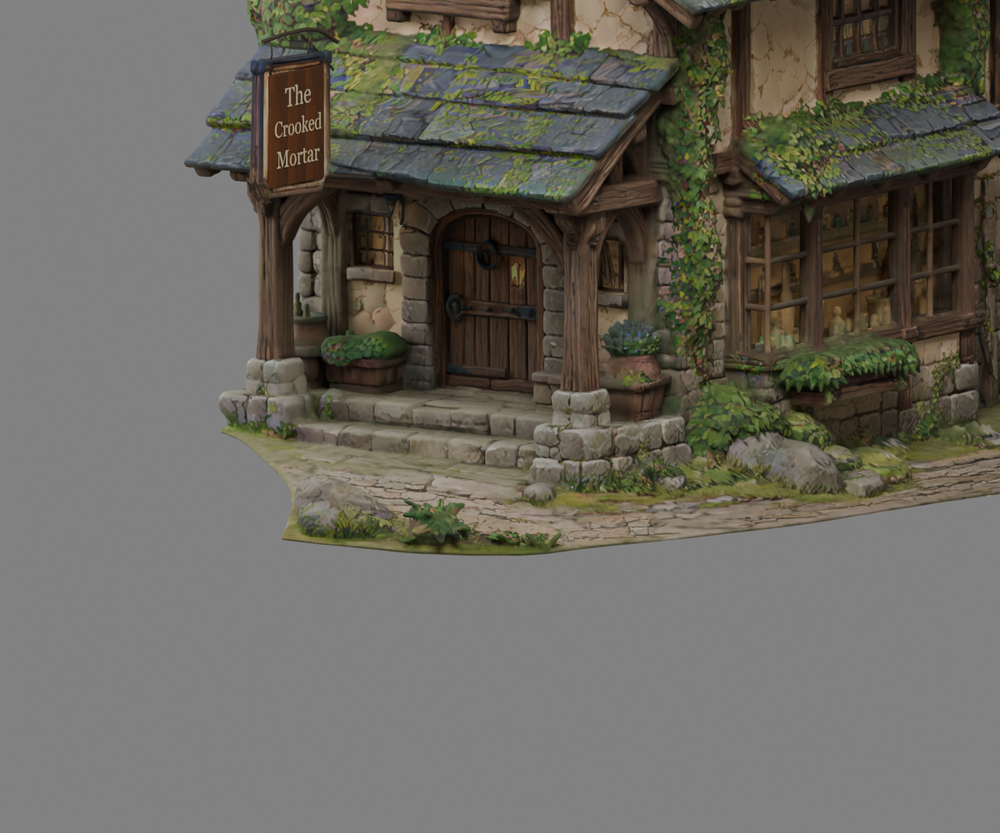
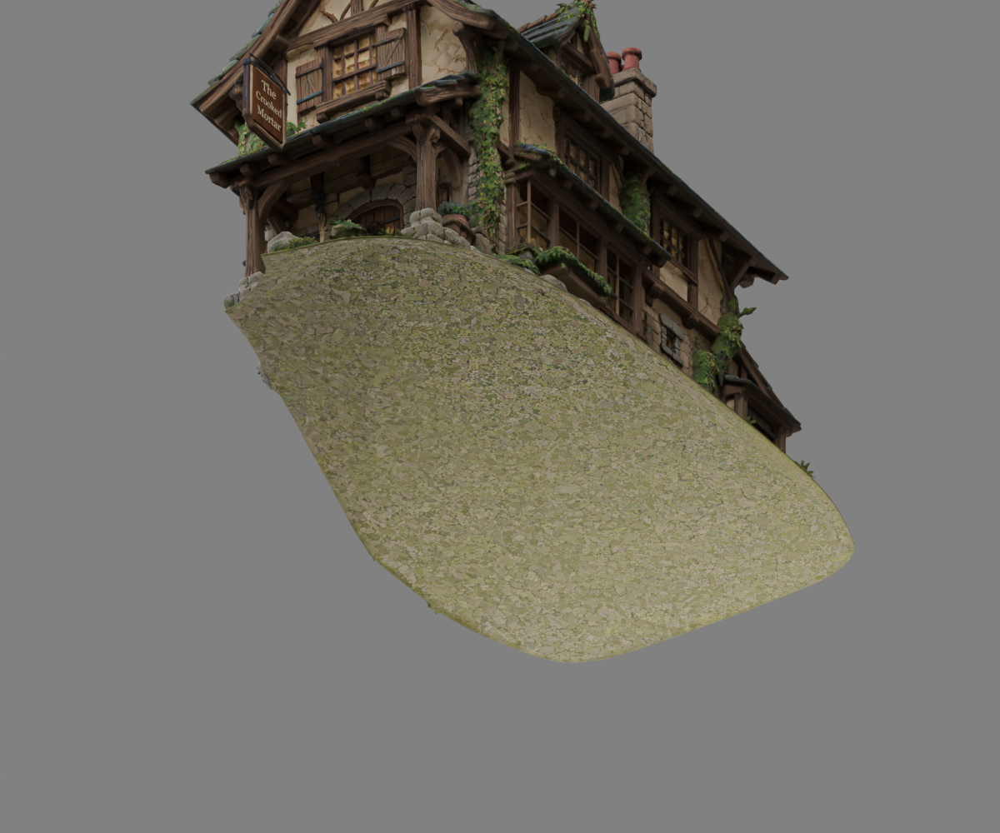
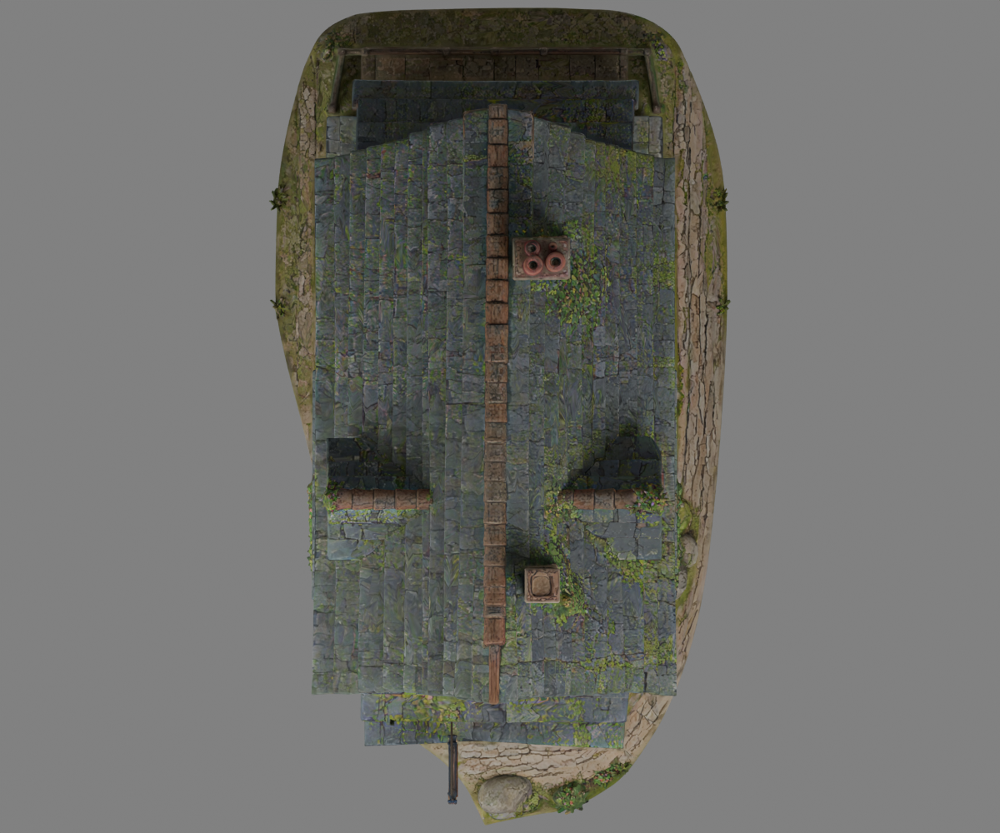

# Crooked Mortar standalone exterior — separation assessment

**Status: stopped before removal under the user's fused-geometry safety condition. No standalone building is claimed or exported.**

## Confirmed findings

- Inspected the saved `TripoExteriorRecovery01/CrookedMortar_Optimized.blend` directly, not merely the old report. The body has **521,906 triangles / 260,925 vertices**.
- The body has two topological components. The main component contains **521,771 triangles (99.974%)**, spanning the full terrain platform, structural foundation, walls and roof. The remaining 135-triangle component is at approximately 5.4 m height; it is not the terrain platform and was not removed.
- Neither the decorative platform nor the entrance cobblestone path is a separate mesh or detachable connected island. The body uses the same source material/UV layout for building and terrain. The independent sign/repair objects do not provide a terrain boundary.
- Underside and foundation views confirm that the ground surface extends underneath the house; a finished, independently bounded foundation underside is not exposed for simple extraction.
- Height thresholds from 0.10–1.15 m cross 861–3,448 body triangles. These are **diagnostic counts, not cut rules**. Threshold deletion would mix terrain with foundation, steps, supports, planters and low attached vegetation. A rectangular footprint crop would likewise risk trimming projecting structural stones or retaining strips of paths/weeds.
- The existing 45 m Unity test ground is already **outside** the house prefab. Removing that scene object would not remove Tripo's platform.
- Existing collision, ground/stoop proxy and front-door marker are also scene siblings, not part of the current render-only prefab. The **6,404-triangle terrain/stoop collision proxy** combines surfaces that must be removed with steps that must be retained; it cannot be copied unchanged into a ground-free prefab.
- Existing front-door marker is at Unity `(0, 1.11, 4.65)` metres. Preserve its relationship to the doorstep when the eventual building pivot is changed.
- Current recorded full render asset: **527,497 triangles**, unchanged. There is no new standalone triangle count yet.

## Why no automatic separation was attempted

Connectivity alone does not make separation impossible. It does mean loose-part extraction cannot do it. A safe result needs an explicitly authored boundary around the structural perimeter, retaining every foundation stone, porch support base and complete stair block. Removing the surrounding continuous surface also exposes lower/underside areas that need deliberate closure and texture treatment. That is partial foundation/perimeter reconstruction, beyond a straightforward extraction.

The user explicitly requested reporting this case rather than damaging the building. Accordingly, **no faces were deleted, moved, decimated, retextured or cut**. There is no masked-off fake standalone prefab, and no claim that the attached platform has disappeared.

## Recommended safe next step for approval

1. In a new editable copy, manually identify and mark the terrain/foundation contact boundary from all four elevations and below. Treat porch steps, foundation projections and attached plants as keep regions, not generic ground-level geometry. Present this boundary overlay for review before cutting.
2. Split along that approved irregular contour, preserving the kept face UVs/material assignments. Remove only the terrain-side selection, with individual checks for fused weeds/rocks versus attached ivy/planters. Leave roof, walls, windows, sign and all upper geometry unchanged.
3. Reconstruct only newly exposed **lower foundation returns and underside closures**. Preserve original external stones; introduce no new visible architectural design. Fit closures inside existing stone contours and transfer matching source texture coordinates where visible. Hidden underside surfaces may be simple, but may not replace or flatten the visible foundation.
4. Establish a level placement datum at the retained foundation's contact surface. Move the asset origin near the footprint centre, with no scale change. Move the door marker and simplified wall/post colliders by the same offset; prepare a new collision mesh containing only the retained porch/steps rather than the old terrain proxy.
5. Export under a new standalone name, reusing the current four shared Unity materials. Build a new prefab containing building visuals, appropriate building/step colliders and marker, **no terrain**. Test on a separate temporary plane and verify independent translation/rotation of the prefab.
6. Deliver front three-quarter, side, rear and underside comparisons plus isolated Unity-prefab screenshots. Inspect the complete new lower perimeter for missing stones, seams, foliage fragments and terrain remnants before approval.

This is a bounded lower-perimeter repair, not a redesign, restyle, new optimization or interior project. It requires authorization for that reconstruction step rather than an unreviewed automated crop.

## Files produced and tests performed

- `SeparationInspection_UNCUT.blend`: new inspection copy with the existing asset intact plus neutral inspection camera/lights; old sources remain unchanged. Original, repaired-high and optimized collections are retained as in the source file.
- `SeparationInspection.json`: current mesh connectivity, component bounds and diagnostic height intersections.
- `InspectionArrays.npz`: analysis-only vertex/triangle/component data.
- `inspect_separation.py`: reproducible read-only source inspection and new-copy rendering.
- `Existing_FrontThreeQuarter.png`, `Existing_Underside.png`, `FoundationAndStoop.png`, `Existing_Plan.png`: actual Blender renders of the **existing uncut asset**, not promised standalone results.
- `PreservedSources.json`: file hashes of the optimized/high-detail sources and existing exterior/interior scenes at the end of inspection. The optimized source still matches the hash computed before inspection.

Read-only Unity hierarchy inspection confirmed the ground, marker and collision-proxy relationships above. No Unity assets/scenes were created or modified; no gameplay or compilation regression pass was warranted for this analysis-only outcome. Existing exterior scene remains open and clean in Edit mode. Standalone placement, underside-removal, export and prefab validation are **not performed**, because no safe standalone candidate exists yet.

Git checkpoint found: `196e485` — Crooked Mortar exterior recovery and Unity scene setup. The existing editable recovery `.blend` files currently appear as untracked files; they were preserved on disk and were not staged, deleted or overwritten. Do not assume that checkpoint alone contains those editable sources.

**No commit or push.**

## Inspection images (uncut baseline)

