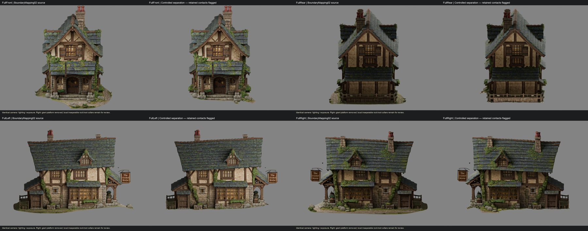

# Crooked Mortar — controlled terrain separation 01

**Blender-only review candidate. Main terrain platform removed; several inseparable local contacts remain deliberately retained. STOPPED for approval. This is not a fully terrain-free, production-approved export.**

Open [CM_CrookedMortar_TerrainSeparated01.blend](CM_CrookedMortar_TerrainSeparated01.blend).

## Result and limitations first

The large surrounding cobbled apron, continuous terrain underside and detached foreground fragments have been removed. The building, porch, complete step run, masonry supports, window boxes, annex beds/containers, sign, roofs and rear rail/platform remain visually recognizable and intact in the comparisons.

Two attempted rock-contact reconstructions failed artistic review. They were rejected rather than accepted as replacement architecture. The final candidate restores the original left boulder and right rock/ivy-root cluster, including small fused original ground collars. The small front toe-pebble contact was also restored after its topology prevented a clean local cut. These are **unresolved removal areas**, not approved changes to the keep/remove decisions. This follows the instruction to leave unsafe sections intact and continue with independently safe sections.

The result therefore removes the giant base, but **does not remove every originally excluded rock, weed or moss patch**. Final approval of a completely standalone terrain-free asset still needs manual work on those contacts. No claim of full game readiness is made.

## Counts

| Item | Triangles |
|---|---:|
| BoundaryMapping02 complete rendered reference | 527,497 |
| Original body triangles removed, net of restored contacts | 25,324 |
| Original body triangles retained | 496,582 |
| New fitted underside/contact closure triangles | 1,190 |
| Final body | 497,772 |
| Unchanged supporting sign/fitted meshes and evaluated lettering | 5,591 |
| **Final complete rendered candidate** | **503,363** |

This is separation, not another optimization pass. No global decimation, remesh, smoothing, silhouette changes or rescaling were performed. Hidden reference collections are not included in the candidate count.

## Method and preservation

1. Read both boundary reports and created `CM_CrookedMortar_TerrainSeparation01_UNCUT_RECOVERY.blend` as a new duplicate. Mapping01, Mapping02, original imports and repaired/optimized recovery sources were not overwritten.
2. Ray-picked local contact faces from close-up views; traced existing mesh-edge paths in short local corridors using the approved guides as references. Cyan guides were never treated as exact cutting operands.
3. Rejected an unrestricted connectivity flood when it spread through hidden underside connections into architecture. No faces were deleted by that rejected selection.
4. Omitted selected existing terrain faces in independently inspectable front, right, rear, left and underside stages. These were script-assisted per-face selections bounded by the varied local perimeter contacts, **not** a single horizontal cut, rectangular crop, Boolean or whole-house connected-component deletion. Raw stage captures/checkpoints document inspection after each section.
5. Constructed closures only where terrain removal exposed the lower shell. Initial striped UV samples and two visible rock-return reconstructions were rejected. The final version restores those contacts and uses a separately reprojected sample of an intact source foundation panel only on newly created closure faces. Original texture images and visible source UVs were never repainted.
6. Removed inspected detached low terrain chips and foreground path bridges. Preserved the source's separate upper 135-triangle feature. Repaired conflicting generated cap diagonals and completed the remaining small lower contact loops without changing retained architectural vertices.
7. Compared the final copy against Mapping02 directly, using stored object/parent transforms rather than unevaluated cached world matrices on excluded hidden references.

New closures are zero-thickness lower-shell caps bounded by the retained contact edges. They do not add a raised foundation block, new terrain platform, terrain skirt or enlarged building footprint. The underside is shown openly in the review renders. Its repeated stone UV treatment is a utilitarian closure finish, not final underside hero artwork.

## Remaining manual-review areas

| Area | Current state | Safest next step after approval |
|---|---|---|
| Left porch/window-bay boulder | Original boulder, adjoining architectural surfaces and bounded fused collar retained. The failed arch-shaped return is absent from the final asset. | Manually isolate the rock/wall contact in Blender; reconstruct only the genuinely missing back/lower stone surface with properly fitted masonry and registered UVs. Preserve all existing dressed stone faces. |
| Right porch/window-bay ivy and rock chain | Original rooted growth, rock-contact surfaces and local collar retained. No visibly truncated root/rock repair is accepted. | Separate individual rock interfaces from attached stems/foliage with close mesh inspection, then make short hidden stem/lower-return repairs. Do not classify all green faces as terrain. |
| Front toe pebble | Original tiny pebble/contact and small collar restored; generated lower closure repaired around it. | Manual face-level extraction outside the protected lowest step/support footprint. Do not force a selection through structural stone. |
| Left herb-bed toe and rear corner contacts | Small fused stone/soil contacts remain conservatively, beside intact containers/post feet. | Inspect in the close-ups and remove only clearly independent terrain faces; keep complete container bottoms and load-bearing feet. |
| Legacy Tripo topology | Original non-manifold/open edges remain outside the new-cut repair scope. | Review separately before final game export; do not globally remesh this asset to solve a local separation problem. |

The underside inspection set now has **309 retained original faces** in the deliberately preserved contact collars. The continuous giant underside is gone; these localized remnants are explicitly **not** claimed removed.

## Validation

- All 11 original reference meshes in the working file match Mapping02 in geometry, UVs, material slots and stored local/parent transforms.
- Both protected boundary source files retain their pre-task SHA256 hashes. Original imports, textures and recovery files were not written.
- Every retained candidate source vertex and per-corner UV matches its source exactly; original material assignments and material-node definitions match.
- Original corner normals were transferred. Blender's encoding introduces a maximum measured angular deviation of **0.130°**; this was checked separately from geometry/UV identity.
- All original source faces entirely above 0.9 m remain; visual comparisons additionally inspect the low porch bases, lowest step, planter bottoms and rear platform.
- **New open cut-boundary edges: 0. New degenerate closure triangles: 0.**
- Final non-manifold edges with more than two incident faces: **6**, matching the source's six inherited edges. Inherited open edges remaining: **472**. This is not a claim that the entire Tripo asset is watertight.
- Roof, sign/lettering, windows, doors, wall geometry and proportions were not redesigned. Front porch/supports, full steps, annex planting arrangements and rear raised platform were inspected in neutral matching views.
- No Unity files, gameplay systems, interior scenes, colliders or settings were changed. No Unity import/gameplay validation was run because no Unity change/export was authorized.
- Final verification scripts completed. Earlier rejected trials/assertions are retained as development evidence, not passing validation. Blender material-node API deprecation messages are tooling notices.

`FinalValidation.json` is authoritative. `FinalRemovedSourceFaces.npy` identifies exact removed original body face indices against the preserved Mapping02 body. `RestoredContactCollars.json` and `RestoredToeFaces.json` record conservative restorations. Earlier stage/selection counts are trial history, not final counts.

## Matched review renders

All pairs use identical camera positions, exposure, lighting and framing. No depth of field or concealment lighting was added.

| View | Comparison |
|---|---|
| Full front | [FullFront_Comparison.jpg](FullFront_Comparison.jpg) |
| Full rear | [FullRear_Comparison.jpg](FullRear_Comparison.jpg) |
| Full left | [FullLeft_Comparison.jpg](FullLeft_Comparison.jpg) |
| Full right | [FullRight_Comparison.jpg](FullRight_Comparison.jpg) |
| Three-quarter overview | [Overview_Comparison.jpg](Overview_Comparison.jpg) |
| Underside | [Underside_Comparison.jpg](Underside_Comparison.jpg) |
| Left porch/support/steps | [PorchLeft_Comparison.jpg](PorchLeft_Comparison.jpg) |
| Right porch/support/steps | [PorchRight_Comparison.jpg](PorchRight_Comparison.jpg) |
| Left retained rock contact | [RockIvyLeft_Comparison.jpg](RockIvyLeft_Comparison.jpg) |
| Right retained root/rock contact | [RockIvyRight_Comparison.jpg](RockIvyRight_Comparison.jpg) |
| Left planter closure/contact | [PlanterLeft_Comparison.jpg](PlanterLeft_Comparison.jpg) |
| Right planter closure/contact | [PlanterRight_Comparison.jpg](PlanterRight_Comparison.jpg) |

## File organization and handoff

- **Review this file:** `CM_CrookedMortar_TerrainSeparated01.blend`. `STANDALONE_WORKING_CANDIDATE` contains the body and duplicated supporting sign/trim, under `CM_CrookedMortar_Standalone01_REVIEW`. Original geometry is excluded from presentation, not deleted.
- `CM_CrookedMortar_TerrainSeparation01_UNCUT_RECOVERY.blend` is the untouched task-start recovery copy.
- `Stage01`–`Stage05`, `SafeSeparated_*`, `CM_CrookedMortar_TerrainSeparation01_WORKING`, the rejected repair images and `RejectedTrials/` are intermediate/rejected inspection history. **They are not the final deliverable.** Read scripts before rerunning; early trials deliberately reject unsafe selections.
- `FoundationReturn_MatchedStone.png` and `FoundationReturn_Normal.png` are source-reprojected maps used only by new closures. They are packed into the final blend. `FoundationReprojection.npz` and scoped scripts preserve the reproducible sampling method.
- All additions are inside this new `TerrainSeparation01/` directory. `CreatedFiles.txt` lists the output inventory. Existing unrelated working-tree changes were left alone.

**No Unity scene, prefab or final FBX/GLB export was created. No commit or push. Await approval/manual-contact direction before further separation or integration.**
