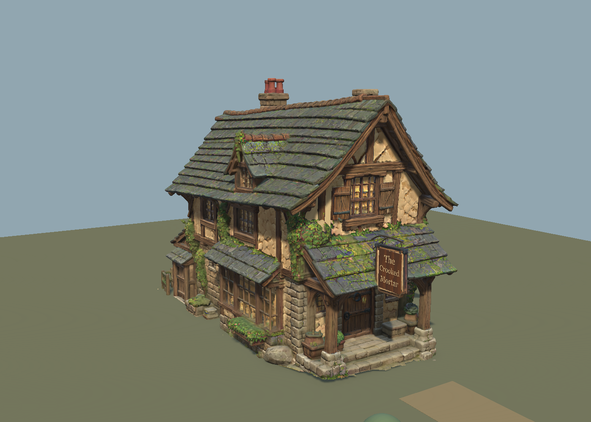

# Crooked Mortar — standalone Unity test 01

**Working candidate exported and tested; STOPPED for artistic/technical approval. No production integration.**

## Open / place

- Scene: `Assets/Scenes/CM_CrookedMortar_Exterior_StandaloneTest01.unity` — left open, clean, in the existing Unity Editor, Edit mode.
- Reusable prefab: `Assets/BlightBloom/Art/Exteriors/CrookedMortar/Standalone01/Prefabs/CM_CrookedMortar_Standalone01.prefab`.
- Imported FBX: `Assets/BlightBloom/Art/Exteriors/CrookedMortar/Standalone01/Models/CM_CrookedMortar_Standalone01.fbx`.
- Transport/source manifest: `Exports/CM_CrookedMortar_Standalone01.fbx`, `ExportManifest.json`. Editable approved source remains `../TerrainSeparation01/CM_CrookedMortar_TerrainSeparated01.blend` with SHA256 `9fe03634d4a5951bace2d65f022a449a5686eabc27f5b2ff39583d5f6f62fbbf` unchanged.

The prefab includes the building, provisional exterior collision, front-door transition marker/feet point and placement datum. Terrain, path, temporary 2m reference/controller, cameras and lights are scene siblings, **not** prefab contents. Adjust `Independent_Adjustable_Terrain_45m` using its separate TerrainData or transform; move/rotate the prefab independently. Root scale is (1,1,1), Unity Y-up/front +Z. Existing FBX conversion also changes the X coordinate convention.

The source-Z 0.58m placement datum is represented by a -0.58m offset of visuals and collision inside the wrapper. This is a placement offset, not scaling, cutting, mesh reconstruction or a replacement foundation. The first inspected placement at Z0.30m floated above the flat terrain and was corrected. Low retained collars extend below this terrain datum; the underside view deliberately hides the ground so this is not concealed. Future village terrain needs local fitting around the irregular foundation and steps.

## Export / import result

| Measure | Result |
|---|---:|
| Complete visible building | **503,363 triangles** |
| Renderers | 15 |
| Unique building materials | 5 |
| Render material slots | 16 |
| Model bounds, width × depth × height | 7.254 × 13.756 × 9.626 m |
| FBX file | 16.39 MB |
| Export/load preparation | 3.41 seconds (FBX operator reported ~1.49s) |
| Unity import + new texture/material setup | **4.44 seconds** |
| Collision-only retained-surface proxy | 6,508 triangles |
| Provisional building/post/closed-door boxes | 7 |
| Free disk at final file validation | **11.23 GB** |

Only `STANDALONE_WORKING_CANDIDATE` was evaluated/exported. Text and curves became temporary export meshes, preserving the sign and bracket. Hidden original/reference/terrain/guide collections were excluded. The source was never saved. Existing four approved URP materials/maps are reused, plus the new closure material and byte-copied 768×512 maps with NPOT resizing disabled. No original texture/material was edited. The separate temporary terrain uses a matte RGB texture so its alpha does not create an unintended glossy patch.

## Validation performed

- Unity imports exactly the approved total triangle count. All mesh UV and normal arrays are complete; zero nonfinite vertices, zero zero-length/invalid normals, zero missing material slots, zero missing scripts. Sign reads **The Crooked Mortar** on the existing modeled boards. This is an import check, not a new whole-model watertightness certification.
- Translated the single prefab to (11,0,-9)m and rotated 25° around Y. Sampled vertices followed the expected root matrix within 0.000000983m. Ground transform, path transform and TerrainData heights were unchanged. Placement was restored. Geometry/collision/marker are children of the movable wrapper; neither terrain nor approach path is inside it.
- Play mode entered/exited normally. Existing unchanged CharacterController: height2m, radius0.4m, step0.3m. Six automated CharacterController.Move connections reached the exterior perimeter and front-step approach, with grounded endpoints; normal motor/orbit components and original position were restored. This **did not inject keyboard input**, does not verify manual camera comfort, and is not full rear-platform/railing safety certification.
- Actual Play-mode orbit-camera render captured; separate player-height/entrance/rear/contact/underside renders inspected. No post-processing/DOF was used to obscure defects.
- New collision proxy is selected from the retained upward-facing source surfaces only. The old ground/stoop collider was not copied. Collision is provisional: coarse side/rear blockers and incomplete detailed rail/foliage collision remain, so future gameplay integration requires a dedicated collision pass. Cosmetic source foliage is not independently collidable.
- Final Unity Console: no current errors/warnings, compilationFailed=false. No new warning/error entries after baseline cursor363. Historical Pipeline timeout entries existed before this task and were not reproduced. A report JSON serialization failure was corrected without rerunning scene construction; a tool capture initially saved to its Assets-relative default and that task-created duplicate was relocated/removed through AssetDatabase. Neither event changed old scenes/assets.
- SHA256 checks match the source and **all 21 pre-existing Unity scenes**, including Production02, StyledDetails07, UsabilityBlockout01, Workflow reviews and Exterior_Dev01. Tracked diff scope contains only pre-existing .DS_Store changes; all deliverables are new paths. No shared gameplay scripts, settings, original assets or production scenes were changed. No commit/push.

## Performance assessment and limits

`PerformanceReport.json` records import timing, object-memory measurements and a Play-mode Editor snapshot. The new FBX imported promptly and disk stayed above11GB; the measured setup consumed about 40.4MB of additional free space during that call, not the complete task footprint.

This remains a heavy hero/landmark asset: about 42.9MB of Editor-reported render-mesh object memory and 153.8MB of shared texture object memory. These are Unity object allocations, not a certified VRAM budget. The existing imported maps/materials were preserved instead of retuned globally.

Play-mode stats showed105 submitted draw calls,21 set-pass calls and3,021,897 submitted triangles across rendering passes/Editor context; that is **not** the asset's unique503,363 triangles or a measured single-building draw-call budget. Total Editor allocated memory was1.85GB. CPU frame interval was~101ms; GPU timing returned0/unavailable. Offscreen Camera.Render calls were around1–4ms after warm-up, excluding GPU completion/readback/encoding. None of these establish acceptable shipping FPS. No standalone build, GPU profile, village load test, LOD or further optimization was performed.

## Visible remaining issues — not repaired in this task

1. Giant original terrain apron/slab is absent, but approved retained boulders, ivy-root contacts, small ground collars and toe fragments remain. Some paper-thin/jagged lower edges are visible on flat terrain. They need later manual review, not another unauthorized automatic cut.
2. Flat lower closures/underside have broad stretched/uneven painted fields and visible seams. They are functional approved working closures, not finished hero underside artwork. The source report records472 inherited open edges and6 non-manifold edges; this export does not resolve them.
3. Source close-up roof tiles, under-eave gaps, fused foliage/stone and window highlights retain Tripo distortions. A small previously preserved floating upper fragment is visible near the front upper facade. No new architectural element was removed to hide it.
4. Windows retain warm painted illumination; glazing/emission is not separately authored. Door is fused/closed and the transition marker has **no scene loader or hinge interaction**. Existing BlockoutDoor is a hinge interaction, not a compatible scene-loading system; none was modified or newly implemented.
5. The proxy colliders, marker placement and flat-terrain fit are development setup, not final village integration. Rear platform is visually retained; dedicated collision/access/rail safety remains to be designed/validated if required for player use.

## Review images

| View | Image |
|---|---|
| Front three-quarter | [FrontThreeQuarter.png](FrontThreeQuarter.png) |
| Front | [Front.png](Front.png) |
| Rear | [Rear.png](Rear.png) |
| Side | [Side.png](Side.png) |
| Player eye height (1.7m) | [PlayerHeight.png](PlayerHeight.png) |
| Actual Play-mode existing orbit camera | [PlayMode_ExistingOrbitCamera.png](PlayMode_ExistingOrbitCamera.png) |
| Front entrance / steps | [FrontEntrance.png](FrontEntrance.png) |
| Retained left contact | [RockIvyLeft.png](RockIvyLeft.png) |
| Retained right contact | [RockIvyRight.png](RockIvyRight.png) |
| Rear raised platform | [RearPlatform.png](RearPlatform.png) |
| Sign lettering | [Sign.png](Sign.png) |
| Underside — terrain/path/reference hidden only for this inspection | [Underside_GroundHiddenForInspection.png](Underside_GroundHiddenForInspection.png) |
| Translated/rotated independently | [MovedIndependently.png](MovedIndependently.png) |

## Added files / reproduction

- New `Assets/BlightBloom/Art/Exteriors/CrookedMortar/Standalone01/` folder: FBX, two closure textures, closure/test-path materials, collision mesh, prefab, independent TerrainData/layer/colour asset and Unity metadata.
- New test scene and its metadata.
- This new `UnityStandaloneTest01/` source/export/report/capture folder. Existing source remains recoverable and unchanged.

Read scripts before execution. `export_standalone.py` refuses to overwrite transport output and never saves the source. `ImportStandalone.cs` and `CreateStandaloneTest.cs` are guarded one-time setup records; do not blindly rerun over current assets/scene. `ValidateAndCapture.cs` temporarily moves the prefab and hides terrain for underside inspection, restoring normal state. `ProbeExteriorPlay.cs` temporarily disables the motor/orbit for its synchronous collision probe and restores them. `CapturePlay.cs` captures the actual current Play-mode camera.

**STOPPED for approval. No production exterior/interior integration, further cutting, reconstruction, package installation, commit or push.**
